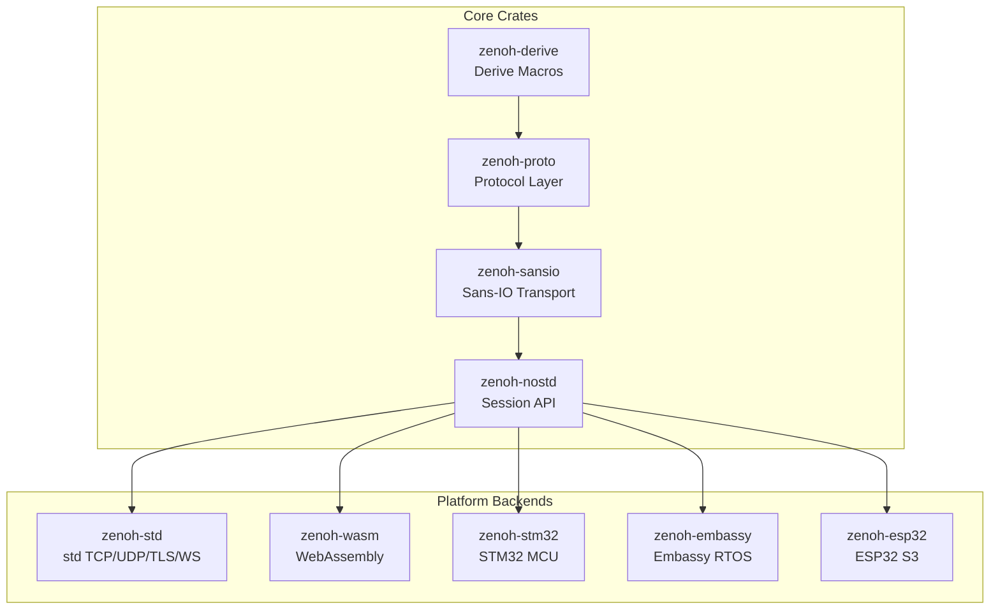

<p align="center">
  
</p>

<h1 align="center">zenoh-nostd</h1>
<p align="center">
  <strong>Zero Network Overhead. Async. No std. No alloc. Pure Rust.</strong>
</p>
<p align="center">
  <code>async</code> • <code>bare-metal</code> • <code>no_std</code> • <code>zenoh</code>
</p>
<a href="https://cla-assistant.io/ZettaScaleLabs/zenoh-nostd"></a>

---

## 📦 Overview

⚠️ This project is in early development.

**zenoh-nostd** is a Rust-native, `async`, `#![no_std]`, `no_alloc` library that provides a **zero-overhead network abstraction layer** for ultra-constrained and bare-metal environments.

> ⚡ Built on the [Zenoh protocol](https://github.com/eclipse-zenoh/zenoh), but stripped to the bone for minimalism and raw performance.

## 🏗️ Architecture



## ✨ Key Features

- **`#![no_std]` + `no_alloc`** — Zero heap dependency; runs on bare-metal MCUs
- **Embassy Integration** — Async via Embassy runtime for Cortex-M microcontrollers
- **Multi-protocol** — TCP, UDP, TLS, WebSocket, BLE, Raw Ethernet, Serial
- **Pub/Sub/Query** — Full Zenoh data-plane: publish, subscribe, get, put, query
- **Broker** — Standalone `no_std` broker to mesh multiple clients, with optional gateway to full Zenoh

## ⚡ Quick Start

```bash
# Check the project
just check

# Run tests
just test

# Build for std (Linux/macOS)
just std z_pub

# Build for ESP32-S3 (requires ESP-IDF toolchain)
WIFI_PASSWORD=* just esp32s3 z_sub
```

## 🔧 Installation

Add this to your `Cargo.toml`:

```toml
[dependencies]
zenoh-nostd = { git = "https://github.com/ZettaScaleLabs/zenoh-nostd" }
```

Minimal example:

```rust
async fn entry(spawner: embassy_executor::Spawner) -> zenoh::ZResult<()> {
    let config = init_session_example(&spawner).await;
    let mut resources = Resources::default();
    let session = zenoh::connect(&mut resources, &config, Endpoint::try_from(ENDPOINT)?).await?;

    let ke = zenoh::keyexpr::new("demo/example")?;
    session.put(ke, b"Hello, from no-std!").finish().await?;
    Ok(())
}
```

## 🔬 MSRV

Rust `1.91.0`

## ⚠️ Limitations

* No serial support yet. ([#11](https://github.com/ZettaScaleLabs/zenoh-nostd/issues/11))
* `Interest` protocol not implemented yet. ([#46](https://github.com/ZettaScaleLabs/zenoh-nostd/issues/46))

## 🧪 Building and Testing

```bash
# Justfile: just <platform> <example> [features]
ENDPOINT=tcp/127.0.0.1:7447 just std z_pub
WIFI_PASSWORD=* ENDPOINT=tcp/192.168.21.1:7447 just esp32s3 z_sub
ENDPOINT=ws/127.0.0.1:7446 just wasm z_pub
```

Examples: `z_get`, `z_ping`, `z_pong`, `z_pub`, `z_sub`, `z_put`, `z_broker` (alloc).

## 📁 Project Layout

```text
zenoh-nostd/
├── crates/
│   ├── zenoh-derive/    Derive macros
│   ├── zenoh-proto/     Protocol layer (bytes, codec, msgs)
│   ├── zenoh-sansio/    Sans-IO transport
│   └── zenoh-nostd/     Session API (pub/sub/query)
├── platforms/
│   ├── zenoh-std/       std TCP/UDP/TLS/WS
│   ├── zenoh-wasm/      WebAssembly
│   ├── zenoh-stm32/     STM32 HAL
│   └── zenoh-esp32/     ESP32-S3
└── examples/
    ├── z_pub.rs z_sub.rs z_get.rs ...
    └── z_broker.rs      Broker example
```

## 📚 Documentation

See `docs/` for deeper dives: verification plan, fuzzing strategy, no_std constraints, formal methods, and safety case.
