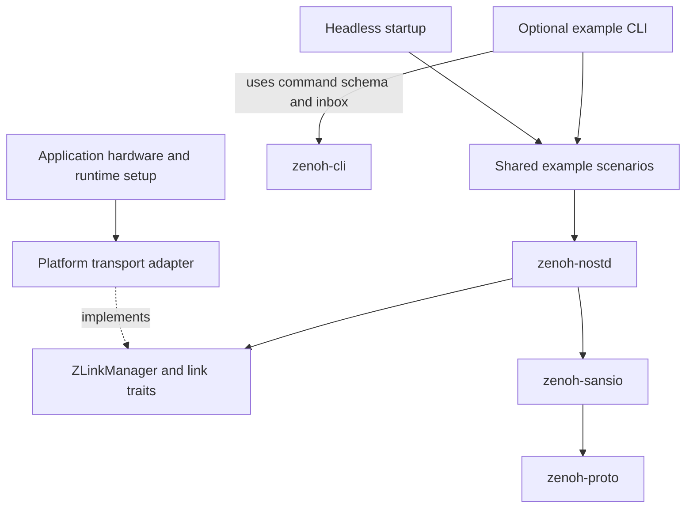

# Architecture and porting

`zenoh-nostd` is an async Rust library with `no_std` and fixed-capacity storage
by default. Applications choose the hardware, networking, runtime, and memory
configuration. MCU support depends on satisfying these requirements, rather
than selecting a board feature in the library.

## Code map

| Location | Responsibility |
| --- | --- |
| [crates/zenoh-derive](../crates/zenoh-derive/) | Derive and helper macros |
| [crates/zenoh-proto](../crates/zenoh-proto/) | Protocol messages, encoding, endpoints, and key expressions |
| [crates/zenoh-sansio](../crates/zenoh-sansio/) | Protocol state machines independent of network I/O |
| [crates/zenoh-nostd](../crates/zenoh-nostd/) | Async sessions, pub/sub/query APIs, storage, transport driving, and optional broker |
| [crates/zenoh-cli](../crates/zenoh-cli/) | Shared Zenoh command schema and bounded inbox for application-owned requests |
| [platforms/](../platforms/) | Transport adapters: host sockets, browser WebSockets, and Embassy networking |
| [examples/common](../examples/common/) | Example configuration, typed scenarios, and optional `embedded-cli` frontend |
| [examples/embassy](../examples/embassy/) | Shared MCU startup/USB helpers and independent board applications |
| [examples/native](../examples/native/), [examples/wasm](../examples/wasm/) | Host and browser applications |

The root is a virtual workspace containing the five crates listed above.
Adapters and example projects have their own manifests, lockfiles, and
workspaces to isolate target requirements and Cargo feature selection.

`zenoh-cli` provides the reusable `ZenohCommand` schema and `CommandInbox`.
The example applications own the console frontend, command execution, scenarios,
console drivers, and HAL setup. An application can reuse the CLI crate in its own
console or call the session API directly.

## Application contract

- **Transport and network:** provide a `ZLinkManager` and links, or use an
  adapter. `zenoh-embassy` borrows an initialized `embassy_net::Stack`; the
  application brings up Wi-Fi/Ethernet and DHCP. `EmbeddedIOLink` can wrap split
  async readers/writers; connection management is still application-owned.
- **Execution and time:** the application supplies the executor and time driver
  and schedules the session driver alongside its operations.
- **Entropy:** the final binary supplies the backend required by the core
  features it selects.
- **Memory:** the application chooses Zenoh buffer and registry capacity via
  `ZSessionConfig` and budgets its network, HAL, and application storage separately.
- **Firmware:** the application owns entry points, panic/logging handlers,
  critical-section support, target/toolchain configuration, linker scripts,
  and the flash runner.

See [ExampleConfig](../examples/common/src/lib.rs), the
[session configuration trait](../crates/zenoh-nostd/src/config.rs), and the
[scenario runner](../examples/common/src/scenarios/runner.rs) for working code.
For session lifetimes, executor constraints, callback locking, and cancellation,
start at the scoped connection example and task index in the
[core crate Rustdoc](../crates/zenoh-nostd/src/lib.rs). Read the relevant type
and method contracts for the revision and features in use.

## Library features

Choose library features explicitly and select one logging backend per application.
Check the feature table in the [core crate Rustdoc](../crates/zenoh-nostd/src/lib.rs)
and the adapter docs for [Embassy](../platforms/zenoh-embassy/src/lib.rs),
[native](../platforms/zenoh-std/src/lib.rs), or [browser](../platforms/zenoh-wasm/src/lib.rs)
endpoint support. The `cli` and `console-usb` features configure example
applications. UART and USB consoles are command interfaces.

## Add an MCU target

1. Start from a similar [board project](../examples/embassy/README.md). Create
   `examples/embassy/<family>/<board>/` with its own `[workspace]`, manifest,
   lockfile, and root workspace `exclude` entry.
2. Configure the HAL, network device, executor/time driver, entropy, memory,
   linker, and runner in that project. Select the smallest adapter feature set
   needed by the application.
3. Reuse `examples/common` for scenarios and its optional CLI. Reuse
   `examples/embassy/headless.rs` for startup scenarios and `usb_console.rs`
   when the board has an `embassy-usb` driver. Keep board pins and peripherals
   in its application; share family-specific setup under the family directory.
4. Keep `cli` enabled by default, UART as the embedded console default, and
   `alloc` independent. Add `console-usb` only when supported; it enables `cli`.
5. Add build/flash recipes to [examples/justfile](../examples/justfile), headless
   checks to [check_headless.py](../examples/common/check_headless.py), and
   release links to [CI](../.github/workflows/ci.yml). Adjust recipe board routing
   when adding a new family. Document console wiring and recovery beside the board.
6. Check fixed/allocated CLI and headless builds, plus supported USB variants.
   Link release firmware as well as running `cargo check`; then perform the
   [hardware smoke test](applications.md#hardware-smoke-test) when a board is available.

Run Cargo **from the target project directory**: `--manifest-path` alone does
not load that project's `.cargo/config.toml`. ESP32-S3 uses `cargo +esp`; C6 and
STM32 use stable Rust. Use release builds for S3 firmware; its board guide
documents the pinned toolchain's debug-link limitation.
